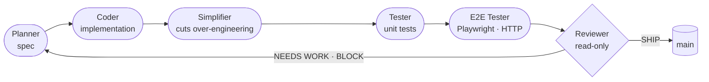

**Software Engineer at Souv** · Recife, Brazil 
Technical owner of end-to-end modules from requirements to production deploy.

 

 

<table align="center">
  <tr>
    <td align="center" width="200"><h2>~75%</h2>less time spent on fixes with my AI delivery pipeline</td>
    <td align="center" width="200"><h2>70%+</h2>reduction in material losses with a unified ops system</td>
    <td align="center" width="200"><h2>+35%</h2>operational efficiency on the same system</td>
    <td align="center" width="200"><h2>+15%</h2>customer satisfaction with support automation</td>
  </tr>
</table>

## What I do

<table>
  <tr>
    <td width="50%" valign="top">

**Product Engineering**
- REST APIs in **NestJS / Express** with PostgreSQL, Prisma and Firebase
- Web and mobile apps with **React, Next.js and React Native**
- Data modeling, integration contracts and authentication

</td>
    <td width="50%" valign="top">

**Data & Optimization**
- **APS (Advanced Planning & Scheduling)** platform for an industrial manufacturer
- **Python / pandas ETL** from SAP and data-warehouse sources
- **Genetic-algorithm** production scheduler and **process mining (PM4Py)**

</td>
  </tr>
  <tr>
    <td width="50%" valign="top">

**AI & Automation**
- **AI agents** and LLM features (OpenAI, Gemini, Claude) in production APIs
- Workflow automation with **n8n** and WhatsApp integrations
- **Multi-agent delivery pipeline** used daily by the team

</td>
    <td width="50%" valign="top">

**Platform & Leadership**
- CI/CD with **GitHub Actions + Docker**, deploys on Vercel and Linux VMs (Nginx, SSL)
- Architecture and team standards, code reviews, mentoring
- Clean Code, SOLID, Design Patterns, Spec Driven Development

</td>
  </tr>
</table>

## Featured Projects

### [pipeline-Claude](https://github.com/Carloscavalcante97/pipeline-Claude) · Multi-agent delivery pipeline

One command turns a feature description into reviewed, tested code through specialized **Claude Code subagents**, with gates between every stage. Used daily on production systems  **~75% less time spent on fixes** compared to an unsupervised AI agent.

- **Spec first** — open questions halt the run until a human answers.
- **Separation of duties** — testers never fix code; the Reviewer can't edit anything and issues `SHIP` · `NEEDS WORK` · `BLOCK`.
- **Auditable** — agents hand off only through files, and every run is archived.

### [stack-cli](https://github.com/Carloscavalcante97/stack-cli) · Full-stack project generator

CLI that scaffolds production-minded full-stack projects: **NestJS, Express or FastAPI** backends with JWT auth, validation, error handling, health check and dependency wiring; **Next.js or Vite + React** frontends; optional **PostgreSQL** (Prisma / SQLAlchemy) and **Redis** via Docker Compose.

## Tech Stack

<table>
  <tr>
    <td><b>Languages</b></td>
    <td>
      
      
    </td>
  </tr>
  <tr>
    <td><b>Backend</b></td>
    <td></td>
  </tr>
  <tr>
    <td><b>Frontend & Mobile</b></td>
    <td>
      
      
    </td>
  </tr>
  <tr>
    <td><b>Databases</b></td>
    <td>
      
      
    </td>
  </tr>
  <tr>
    <td><b>Data & Optimization</b></td>
    <td>
      
      
      
      
      
    </td>
  </tr>
  <tr>
    <td><b>AI & Automation</b></td>
    <td>
      
      
      
      
      
      
    </td>
  </tr>
  <tr>
    <td><b>DevOps & Cloud</b></td>
    <td></td>
  </tr>
</table>

Also: C# / .NET · Java / Spring Boot · MySQL · Oracle

## Experience

- **Souv** · Software Engineer · `Oct 2025 – Present` — end-to-end web, mobile, data and AI modules; architecture, CI/CD and mentoring.
- **Denzel Eventos** · Full Stack Developer · `2025` — unified ops system that **cut material losses by 70%+** and **raised efficiency by 35%**.
- **Pontes Hotéis** · Development Intern · `2025` — support automation with chatbots, **raising CSAT by 15%**.

Systems Analysis and Development · Estácio (2024 – 2026) · Portuguese (native) · English (advanced) · Full history on [LinkedIn](https://linkedin.com/in/antonio-dev-)

   
  

